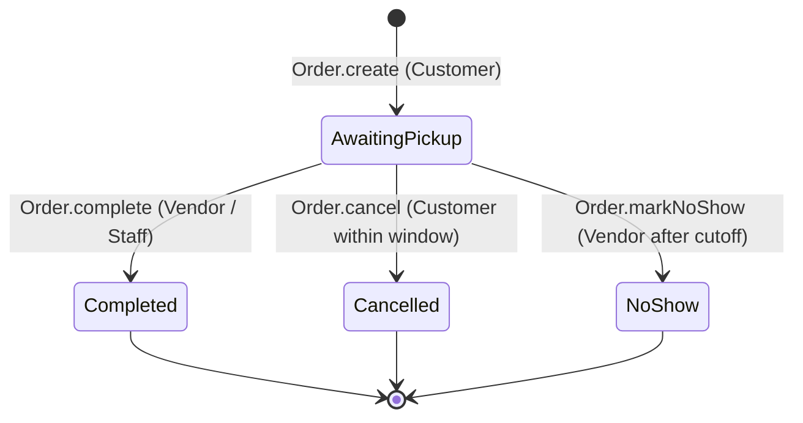

# Basket Roadmap & Target Architecture

This document defines the **aspirational engineering roadmap, target architecture, and prioritized to-do backlog** for Basket. 

For the factual, line-by-line ground truth of the currently running application, see [`SPECIFICATION.md`](../SPECIFICATION.md).

---

## 1. Target Architecture & Engineering Invariants

The target architecture transitions Basket from a client-side prototype to a hardened, server-authoritative multi-tenant platform.

### A. The Strict Method Contract
Every future server-side write method must follow these rules:
1. **Actor parameter:** Every write takes `actor` (authenticated session payload with `id`, `role`, `vendorId`) as its final parameter and enforces ownership and RBAC *inside the model/service method*.
2. **Server-derived values:** All identifiers, created timestamps, snapshot prices, order totals, and status values are computed on the server. No client-supplied totals or status flags are accepted.
3. **Static model methods:** Model operations are static methods on their domain class/module (e.g., `Order.create(data, actor)`).

### B. Order State Machine
Orders must follow an explicit, enforced transition graph:

- Only `vendor` matching `order.vendorId` (or `staff`/`admin`) may transition to `Completed` or `NoShow`.
- `Customer` may only transition to `Cancelled` prior to market morning lock-out (e.g., Friday 5:00 PM).

### C. Review Verification
- Reviews cannot be submitted with client-fabricated `verifiedOrder: true` and randomized `orderId`.
- The system must verify that `actor.id` matches the buyer of an order in state `Completed` for that vendor, and that no prior review exists for that `orderId`.

### D. Multi-Vendor Order Splitting
- A unified cart checkout produces $N$ distinct `Order` documents, each with its own lifecycle, pickup note, and vendor confirmation.

---

## 2. Prioritized To-Do Backlog

### Phase 1: Backend & Security Foundation (Immediate)
- [ ] **Provision Server Datastore & Runtime:**
  - Transition persistence from `localStorage` to a persistent database (PostgreSQL with Drizzle/Prisma or Firestore).
  - Mount backend API / RPC handlers (Express server or edge API routes).
- [ ] **Secure Authentication & Password Hashing:**
  - Replace plaintext password comparisons in `User.login` with Argon2id / bcrypt hashing.
  - Implement secure HTTP-only session cookies or JWT authorization headers.
  - Remove demo account credentials from client bundles in production mode.
- [ ] **Enforce Server-Side RBAC on Mutations:**
  - Implement `actor` middleware on all write endpoints.
  - Block customers from modifying vendor products at the API layer (not just UI route redirects).
  - Scope `Product.update` and `Product.delete` strictly to `actor.vendorId === product.vendorId`.

### Phase 2: Domain Logic & Order Lifecycle (Core Platform)
- [ ] **Authoritative Pricing Engine:**
  - Refactor `Order.placePreOrder` to read authoritative product prices from the database at checkout time.
  - Compute line subtotals and order totals server-side; reject stale client price submissions.
- [ ] **Implement Order Lifecycle Transition Methods:**
  - Add `Order.markPickedUp(orderId, actor)` for vendors to mark cash/debit/e-Transfer received at the stall.
  - Add `Order.cancel(orderId, reason, actor)` with cutoff validation.
  - Add `Order.markNoShow(orderId, actor)` for uncollected morning reserves.
- [ ] **Enforce Verified Order Reviews:**
  - Add foreign key relation validating `Review.orderId` belongs to `actor` and is in `status === 'Completed'`.
  - Prevent multiple reviews on the same order.
- [ ] **Atomic Product Inventory Management:**
  - Replace full-catalog array overwrites (`Product.saveStoredProducts`) with discrete `create`, `update`, `patchAvailability`, and `delete` operations.

### Phase 3: Real-World Market Operations & Polishing
- [ ] **Saturday Morning Vendor Pack Sheets:**
  - Generate printable PDF / thermal receipt sheets for each vendor listing Saturday pre-orders sorted alphabetically by customer name.
- [ ] **Customer Pickup Reminders:**
  - Automated SMS or email notification on market morning (e.g., Saturday 6:30 AM) with stall location and pickup window reminder.
- [ ] **Inventory Reservation Caps:**
  - Add `weeklyQuota` / `quantityAvailable` to `Product` with atomic decrement on reservation to prevent overselling limited crops.
- [ ] **Vendor Stall Re-Assignment:**
  - Dynamic stall booth numbers (e.g., "Row B Stall 14" vs "Outdoor Canopy #42") updated weekly per market manager layout.

---

## 3. Entity Migration Matrix

| Entity | Current Reality (`SPECIFICATION.md`) | Target Implementation (`ROADMAP.md`) |
|---|---|---|
| **User** | Plaintext in `localStorage`, client-side role check | Bcrypt/Argon2 password hash, server session tokens, RBAC middleware |
| **Market** | Static array in `src/data.js` | Database table with seasonal schedule updates and manager announcements |
| **Vendor** | Static array in `src/data.js` | Multi-tenant vendor profiles linked to `User` account with administrative vetting |
| **Product** | Full-array overwrite in `localStorage` | Normalized relational / document rows with scoped vendor ownership guards |
| **CartItem** | Client-only `localStorage` array | Ephemeral Redis session or client-side cart validated against server prices at checkout |
| **Order** | Client-generated ID, client-calculated total | Server-generated UUID/counter, server-calculated totals, atomic multi-vendor split |
| **OrderItem** | Embedded snapshot in client state | Immutable historical line item with captured price, quantity, and unit |
| **Review** | Client-assigned `verifiedOrder: true` | Cryptographically validated link to completed order record |
| **Favourite** | Array of string IDs in `localStorage` | Relational join table `user_favourites (user_id, entity_type, entity_id)` |
