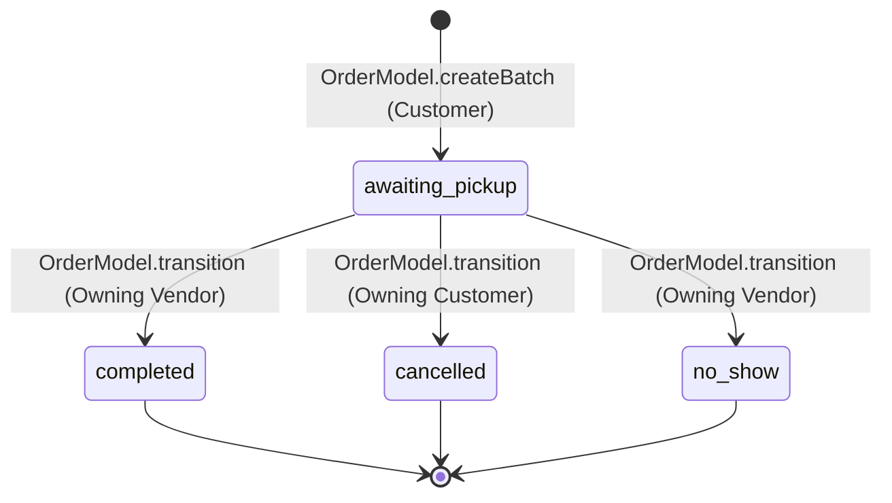

# Basket Roadmap & Target Architecture

This document tracks the **engineering architecture, completed migration milestones, and remaining operational roadmap** for Basket.

For the factual ground truth of the currently running application, see [`SPECIFICATION.md`](../SPECIFICATION.md).

---

## 1. Architecture & Engineering Invariants

Basket runs as a hybrid Supabase + thin Express (`server.ts`) application:

### A. The Method Contract
Every server-side write method in `server/models/*.ts` enforces:
1. **Actor parameter:** Every write takes `actor` (resolved server-side from the Supabase JWT via `UserModel.resolveActorFromToken`) as its final parameter and enforces ownership and RBAC *inside the model method*.
2. **Server-derived values:** All identifiers, created timestamps, snapshot prices (`price_cents_snapshot`), order totals (`total_cents`), and initial order statuses (`awaiting_pickup`) are computed on the server. Client-submitted totals or status flags are ignored.
3. **Model module methods:** Domain operations live in `server/models/*.ts` (`ProductModel`, `OrderModel`, `ReviewModel`, `FavouriteModel`, `UserModel`).

### B. Order State Machine
Enforced inside `OrderModel.transition(orderId, targetStatus, actor)`:

- Only the `vendor` matching `order.vendor_id` may transition an order to `completed` or `no_show`.
- Only the `customer` matching `order.customer_id` may transition an order to `cancelled`.

### C. Review Verification
- Implemented in `ReviewModel.create(input, actor)` and reinforced by RLS policy `reviews_insert_verified_buyer` + `order_id` unique constraint in `supabase/schema.sql`.
- The server verifies `order.customer_id === actor.id`, `order.vendor_id === vendorId`, `order.status === 'completed'`, and that no prior review exists for `order_id`.

### D. Multi-Vendor Order Splitting
- `OrderModel.createBatch` validates all requested product IDs against live Postgres prices and partitions items by `vendor_id`, producing $N$ distinct `orders` rows with immutable `order_items` snapshots.

---

## 2. Engineering Backlog

### Phase 1: Backend & Security Foundation (Completed)
- [x] **Provision Server Datastore & Runtime:**
  - Migrated persistence from `localStorage` to Supabase PostgreSQL (`supabase/schema.sql`, `supabase/seed.sql`) with RLS policies.
  - Mounted Express API (`server.ts`) with Vite middleware in dev and static serving in production on port `3000`.
- [x] **Secure Authentication & Session Handling:**
  - Replaced plaintext `localStorage` credentials with Supabase Auth (`signInWithPassword`, `signUp`, `signOut`, JWT verification via `supabaseAdmin.auth.getUser`).
  - Added database trigger `prevent_profile_role_escalation()` to block client role self-escalation.
  - Added `ENABLE_DEMO_ACCOUNTS=false` toggle on `/api/demo/ensure-accounts` for production deployments.
- [x] **Enforce Server-Side RBAC on Mutations:**
  - Implemented `requireActor` middleware resolving `actor` on all authenticated routes.
  - Enforced `actor.role === 'vendor'`, `actor.isApproved`, and `existing.vendor_id === actor.vendorId` inside `ProductModel`.

### Phase 2: Domain Logic & Order Lifecycle (Completed)
- [x] **Authoritative Pricing Engine:**
  - `OrderModel.createBatch` reads `price_cents` and `is_available` from PostgreSQL at checkout time and computes `total_cents` server-side in integer cents.
- [x] **Implement Order Lifecycle Transition Methods:**
  - Implemented `OrderModel.transition` supporting `completed`, `no_show` (vendor actions on Dashboard), and `cancelled` (customer action on Account page).
- [x] **Enforce Verified Order Reviews:**
  - `ReviewModel.create` validates completed-order ownership and enforces one review per order.
- [x] **Atomic Product Inventory Management:**
  - Replaced `localStorage` full-array overwrites with discrete `ProductModel.create`, `update`, `toggleAvailability`, and `remove`.

### Phase 3: Real-World Market Operations & Polishing (Next)
- [ ] **Admin Approval Queue UI:**
  - Build an internal market coordinator view for approving pending vendors (`vendors.is_approved`) and assigning stall locations without opening the Supabase dashboard.
- [ ] **Pickup Cancellation Cutoff Rule:**
  - Add market-morning lock-out validation (e.g., reject customer cancellations after Friday 5:00 PM) inside `OrderModel.transition`.
- [ ] **Saturday Morning Vendor Pack Sheets:**
  - Generate printable PDF / thermal receipt sheets for each vendor listing Saturday pre-orders sorted alphabetically by customer name.
- [ ] **Customer Pickup Reminders:**
  - Automated SMS or email notification on market morning (e.g., Saturday 6:30 AM) with stall location and pickup window reminder.
- [ ] **Inventory Reservation Caps:**
  - Add `weekly_quota` / `quantity_available` to `products` with atomic decrement inside a Postgres RPC transaction on reservation to prevent overselling limited crops.
- [ ] **Vendor Stall Re-Assignment:**
  - Dynamic stall booth numbers updated weekly per market manager layout.

---

## 3. Entity Status Matrix

| Entity | Previous Prototype | Current Implementation (`SPECIFICATION.md`) |
|---|---|---|
| **User / Actor** | Plaintext in `localStorage` | Supabase Auth + `public.profiles` with RLS & JWT resolution (`UserModel`) |
| **Market** | Static array in `src/data.js` | `public.markets` table in PostgreSQL (public read via RLS) |
| **Vendor** | Static array in `src/data.js` | `public.vendors` table linked to `profiles.id` with `is_approved` gating |
| **Product** | Full-array overwrite in `localStorage` | `public.products` (`price_cents`) with `ProductModel` ownership guards |
| **CartItem** | Client `localStorage` array | Client `localStorage` basket; prices/availability re-validated server-side at checkout |
| **Order** | Client-generated ID & total | `public.orders` (`total_cents`, status state machine) created in `OrderModel.createBatch` |
| **OrderItem** | Embedded array in client state | `public.order_items` relational table with price/name/unit snapshots |
| **Review** | Client-assigned `verifiedOrder: true` | `public.reviews` validated against completed `orders.id` via `ReviewModel.create` |
| **Favourite** | Array of string IDs in `localStorage` | `public.favourites` (`user_id`, `target_type`, `target_id`) with RLS & `FavouriteModel` |
