# Basket Specification (As-Built Ground Truth)

> **Document Status:** Actuality / Ground Truth.  
> This specification describes the codebase **exactly as it is currently implemented**.  
> For the aspirational target architecture, security hardening plan, and prioritized engineering to-do backlog, see [`ROADMAP.md`](./ROADMAP.md).

---

## Architecture Header Block

1. **Trust boundary:** The application runs as a client-side React SPA in the browser. In the current prototype, there is no remote server API or database; all state and persistence are held directly in browser `localStorage`. Security and route gating are enforced via client React components and navigation hooks.
2. **Method contract:** Data operations are implemented as exported helper functions on `src/data.js` and custom hooks/methods on `src/context/AuthContext.jsx`. State synchronization across disparate components is maintained through custom DOM window events (`basket_products_updated`, `basket_orders_updated`, `basket_reviews_updated`).
3. **Entity relationships:** `User 1—0..* Order`, `User 1—0..* Favourite`, `Market 1—1..* Vendor`, `Vendor 1—0..* Product`, `Vendor 1—0..* Review`, `Order 1—1..* OrderItem`; multi-vendor cart checkouts partition items by vendor, producing $N$ distinct vendor orders.
4. **File paths:**
   - `User` → `src/context/AuthContext.jsx`
   - `Market` → `src/data.js`
   - `Vendor` → `src/data.js`
   - `Product` → `src/data.js`
   - `CartItem` → `src/context/AuthContext.jsx`
   - `Order` → `src/data.js` / `src/context/AuthContext.jsx`
   - `OrderItem` → `src/context/AuthContext.jsx`
   - `Review` → `src/data.js` / `src/pages/VendorDetail.jsx`
   - `Favourite` → `src/context/AuthContext.jsx`

---

## 1. User

| Field | Type | Key / Notes |
|---|---|---|
| `email` | `string` | Primary lookup identifier, unique |
| `password` | `string` | Plaintext in prototype demo store; stripped from active session state |
| `firstName` | `string` | User given name |
| `lastName` | `string` | User family name |
| `role` | `string` | Enum: `"customer"`, `"vendor"` |
| `vendorId` | `string \| undefined` | Foreign key to `Vendor.id`; present when `role === "vendor"` |
| `vendorName` | `string \| undefined` | Display name of producer stall |
| `marketId` | `string \| undefined` | Foreign key to `Market.id`; defaults to `"st-jacobs"` on registration |
| `city` | `string \| undefined` | Geographic municipality |
| `isApproved` | `boolean` | `true` for customers; `false` ("Pending admin approval") for new vendor accounts |
| `createdAt` | `string` | ISO calendar date string (`YYYY-MM-DD`) |

### User.login

Authenticates credentials against demo accounts or registered users in local storage; callable by an unauthenticated visitor.

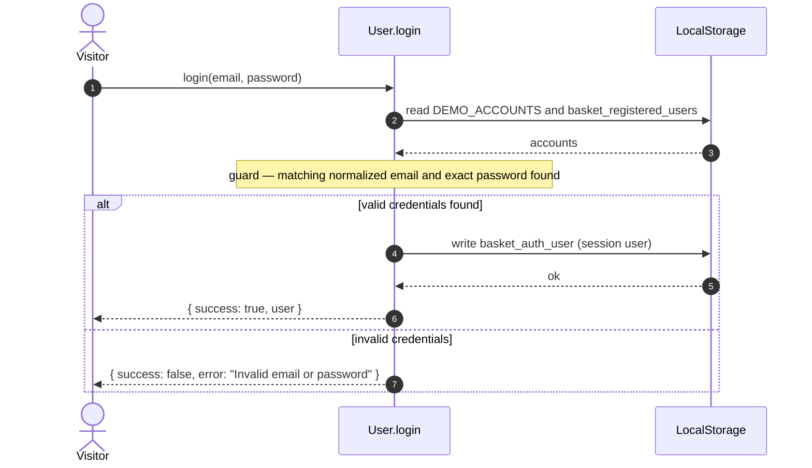

### User.signup

Creates a new customer or vendor account record in local storage and establishes a session; callable by an unauthenticated visitor.

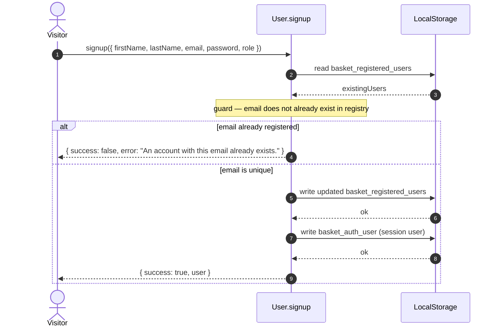

### User.logout

Clears the active session user from memory and local storage; callable by an authenticated user.

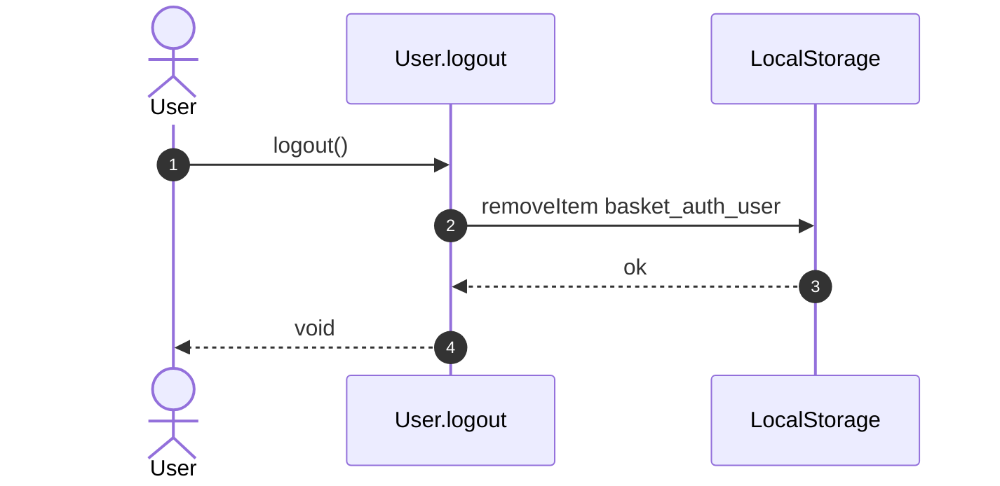

### User.deleteAccount

Removes the user session, resets the pre-order cart, and clears storage keys; callable by an authenticated user.

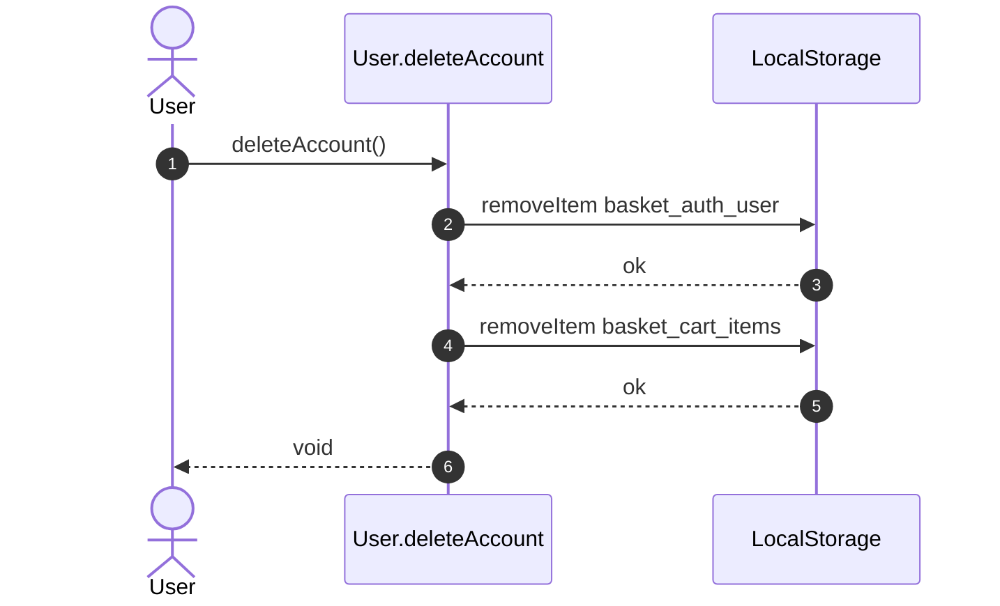

---

## 2. Market

| Field | Type | Key / Notes |
|---|---|---|
| `id` | `string` | Primary key (e.g. `"st-jacobs"`, `"byward"`) |
| `name` | `string` | Formal market name |
| `city` | `string` | Municipality with regional context |
| `region` | `string` | Ontario geographic territory |
| `address` | `string` | Street address with postal code |
| `lat` | `number` | WGS84 latitude coordinate for map pin |
| `lng` | `number` | WGS84 longitude coordinate for map pin |
| `season` | `string` | Operating seasonal calendar |
| `hoursTable` | `Array<{ day: string, hours: string }>` | Operating hours schedule table |
| `summaryHours` | `string` | Abbreviated schedule for overview cards |
| `description` | `string` | Market history and community background |
| `announcement` | `object` | Embedded `{ title, date, content, image }` |
| `vendorIds` | `Array<string>` | Foreign key list to `Vendor.id` |
| `heroImage` | `string` | Banner visual asset URL |

**Methods:** none — read-only catalog initialized from static configuration in `src/data.js`. No separate diagram.

---

## 3. Vendor

| Field | Type | Key / Notes |
|---|---|---|
| `id` | `string` | Primary key (e.g. `"v-harvest-table"`) |
| `name` | `string` | Farm or bakery business name |
| `marketId` | `string` | Foreign key referencing `Market.id` |
| `marketName` | `string` | Denormalized display name of attended market |
| `city` | `string` | Producer home municipality |
| `category` | `string` | Producer category: `"Produce"`, `"Bakery"`, `"Honey & Preserves"`, `"Dairy & Cheese"`, `"Meats & Dairy"` |
| `shortDescription` | `string` | One-sentence summary for cards |
| `fullDescription` | `string` | Detailed agricultural practices narrative |
| `rating` | `number` | Average completed-order star rating (1.0–5.0) |
| `reviewCount` | `number` | Total number of customer reviews |
| `image` | `string` | Card thumbnail image asset URL |
| `bannerImage` | `string` | Stall header image asset URL |
| `stallLocation` | `string` | Physical stall location inside the market |
| `pickupInstructions` | `string` | Customer pickup and payment directions |

**Methods:** none — read-only catalog initialized from static configuration in `src/data.js`. No separate diagram.

---

## 4. Product

| Field | Type | Key / Notes |
|---|---|---|
| `id` | `string` | Primary key (e.g. `"p-sweet-corn"`, `"p-<timestamp>"`) |
| `vendorId` | `string` | Foreign key referencing `Vendor.id` |
| `name` | `string` | Crop or baked item title |
| `price` | `number` | Unit price in CAD |
| `unit` | `string` | Sold unit description (e.g. `"dozen"`, `"loaf"`, `"500ml glass bottle"`) |
| `category` | `string` | Crop category matching vendor domain |
| `description` | `string` | Harvesting notes, culinary profile, storage |
| `isAvailable` | `boolean` | Availability toggle (`true` = available this week, `false` = sold out) |
| `image` | `string` | Thumbnail asset URL |

### Product.getStoredProducts

Retrieves the current product list from local storage or falls back to initial defaults; callable by any visitor, customer, or vendor.

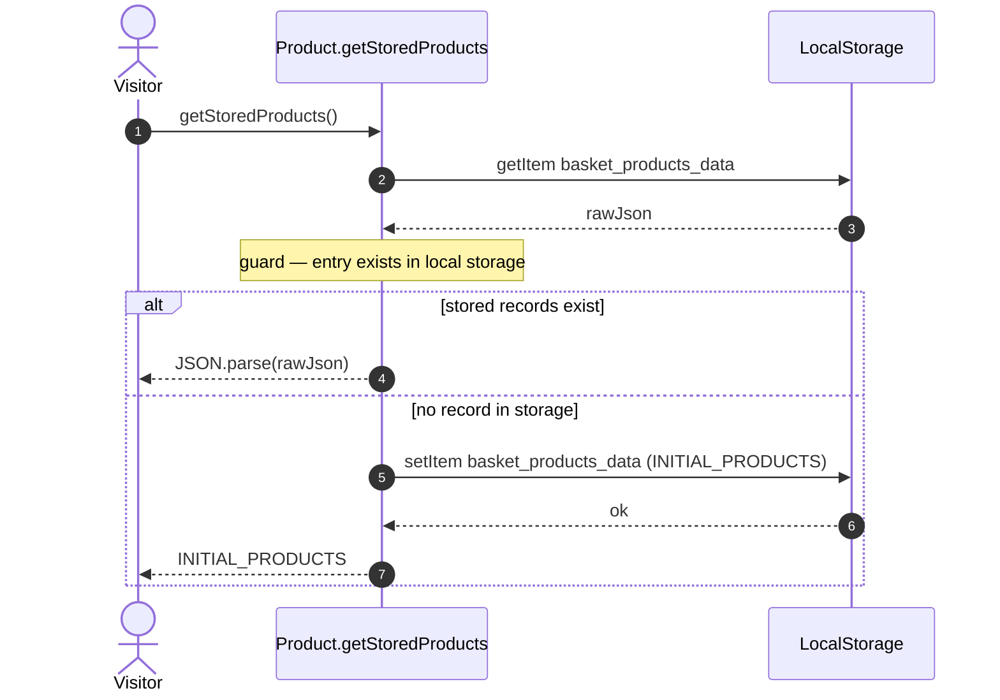

### Product.saveStoredProducts

Persists the full product array into local storage and dispatches a window update event; callable by a vendor from the dashboard.

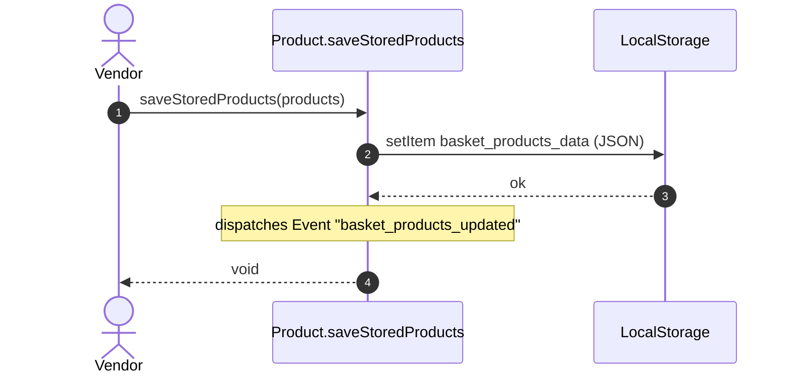

---

## 5. CartItem

| Field | Type | Key / Notes |
|---|---|---|
| `id` | `string` | Primary key (`"cart-item-<timestamp>-<hash>"`) |
| `productId` | `string` | Foreign key referencing `Product.id` |
| `name` | `string` | Denormalized snapshot of product name |
| `price` | `number` | Snapshot unit price in CAD |
| `unit` | `string` | Packaging unit |
| `image` | `string` | Display asset URL |
| `quantity` | `number` | Integer reserve quantity |
| `vendorId` | `string` | Foreign key referencing `Vendor.id` |
| `vendorName` | `string` | Denormalized vendor title |
| `marketId` | `string` | Foreign key referencing `Market.id` |
| `marketName` | `string` | Denormalized market title |
| `stallLocation` | `string` | Stall location instructions |

### CartItem.addToCart

Appends a reserved product to the customer cart or increments existing quantity; callable by a customer.

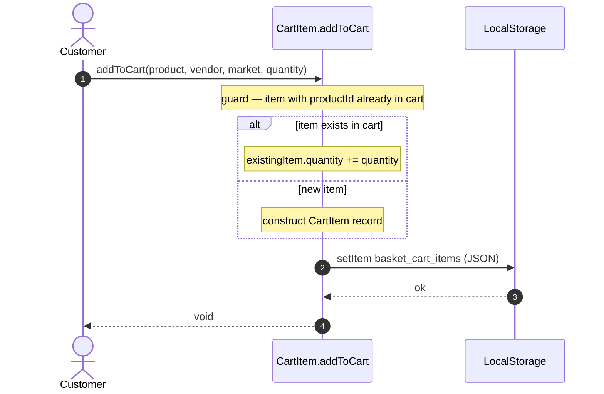

### CartItem.updateCartQuantity

Modifies an item's reserve quantity in the cart or delegates removal if quantity is zero or less; callable by a customer.

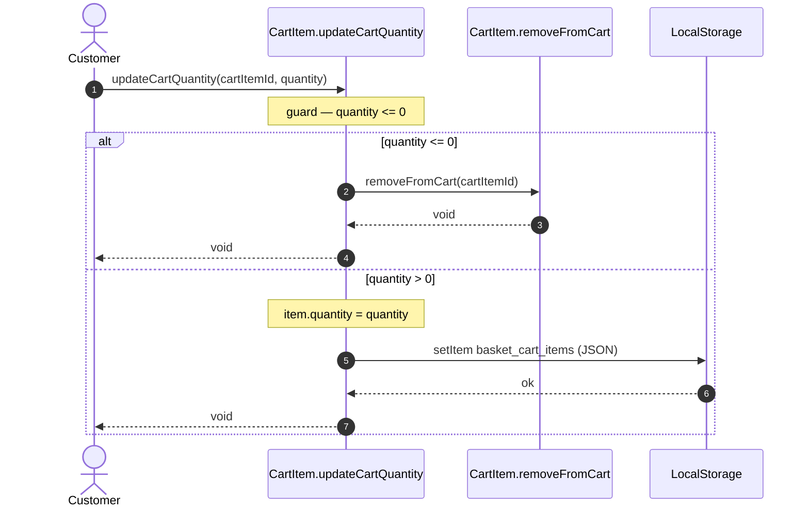

### CartItem.removeFromCart

Deletes a product entry from the active cart state; callable by a customer.

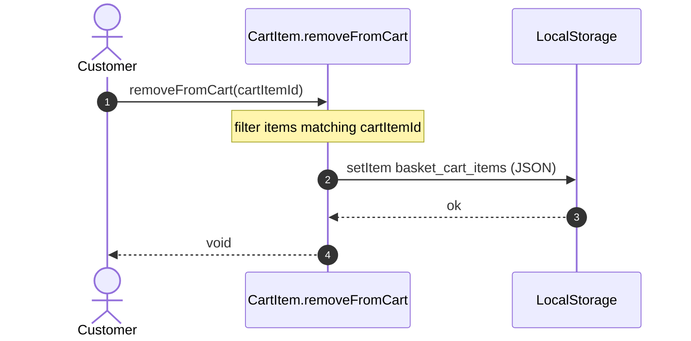

### CartItem.clearCart

Purges all entries from the pre-order cart; callable by a customer or internal order finalization.

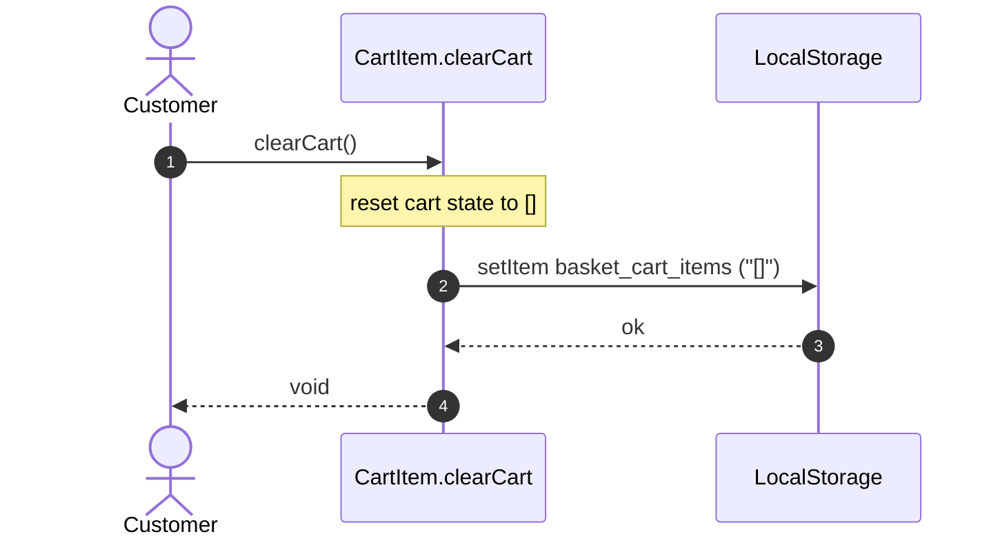

---

## 6. Order

| Field | Type | Key / Notes |
|---|---|---|
| `id` | `string` | Primary key format `"ORD-<4-digit-id>"` |
| `date` | `string` | Order submission date (`YYYY-MM-DD`) |
| `customerEmail` | `string` | Foreign key to `User.email` |
| `customerName` | `string` | Full name of pre-ordering customer |
| `vendorId` | `string` | Foreign key to `Vendor.id` |
| `vendorName` | `string` | Denormalized producer stall title |
| `marketId` | `string` | Foreign key to `Market.id` |
| `marketName` | `string` | Denormalized market title |
| `pickupWindow` | `string` | Selected pickup timeframe |
| `customerNote` | `string` | Optional customer note to grower |
| `items` | `Array<OrderItem>` | Embedded list of reserved crops |
| `total` | `number` | Computed CAD sum due in person at stall |
| `status` | `string` | Enum: `"Awaiting Pickup (Pay in Person)"`, `"Completed (Paid in person)"` |
| `paymentMethod` | `string` | Fixed note: `"Pay in person at pickup (Cash, Debit, or e-Transfer)"` |

### Order.getStoredOrders

Retrieves existing customer and vendor pre-orders from local storage or defaults to initial seed data; callable by an authenticated customer or vendor.

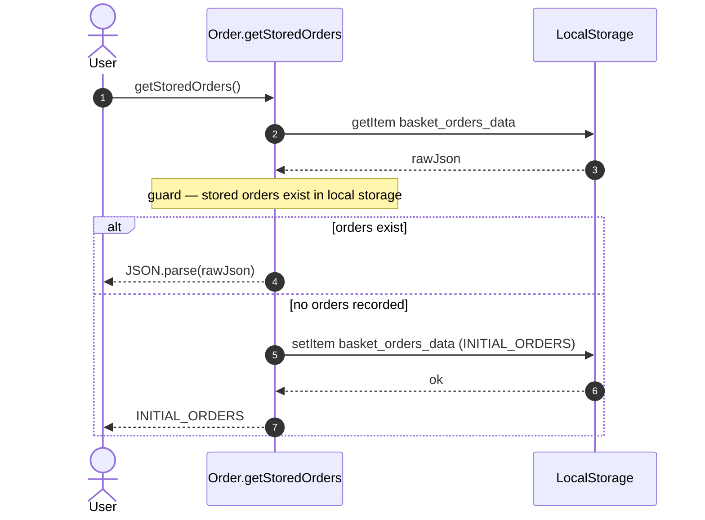

### Order.saveStoredOrders

Persists orders array to local storage and triggers an update event; callable by the pre-order submission routine.

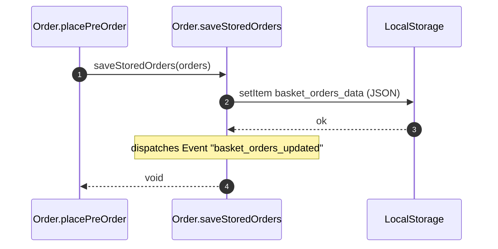

### Order.placePreOrder

Partitions cart items by vendor, generates new order entities with initial status `"Awaiting Pickup (Pay in Person)"`, saves them, and clears the cart; callable by a customer.

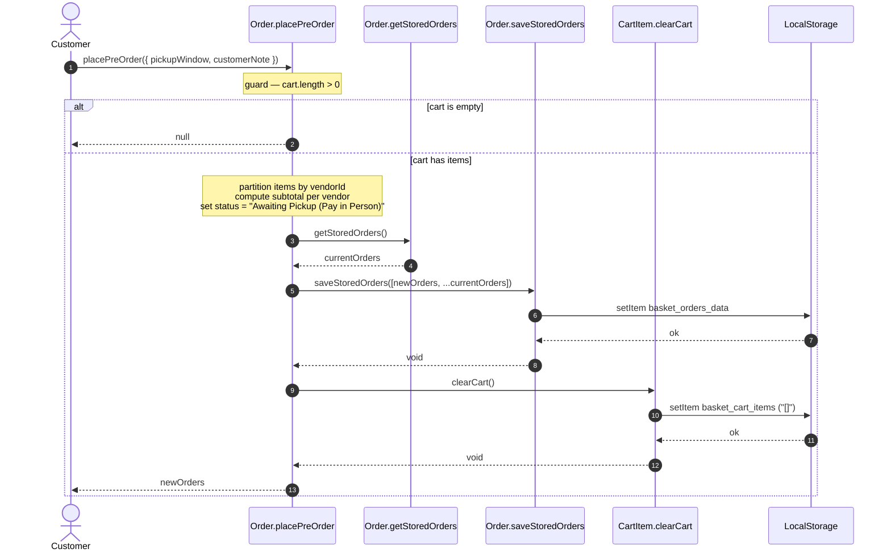

---

## 7. OrderItem

| Field | Type | Key / Notes |
|---|---|---|
| `id` | `string` | Foreign key referencing `Product.id` |
| `name` | `string` | Snapshot crop name at order creation |
| `quantity` | `number` | Quantity reserved |
| `price` | `number` | Snapshot unit price in CAD |
| `unit` | `string` | Snapshot crop packaging unit |

**Methods:** none — embedded document array inside `Order.items` created during `Order.placePreOrder`. No separate diagram.

---

## 8. Review

| Field | Type | Key / Notes |
|---|---|---|
| `id` | `string` | Primary key (`"r-1"`, `"rev-<timestamp>"`) |
| `vendorId` | `string` | Foreign key referencing `Vendor.id` |
| `customerName` | `string` | Customer display name |
| `orderId` | `string` | Foreign key referencing `Order.id` |
| `verifiedOrder` | `boolean` | Set to `true` ("Completed order") |
| `date` | `string` | Human-readable relative date label |
| `rating` | `number` | Integer rating value (1 to 5) |
| `comment` | `string` | Feedback text |

### Review.getStoredReviews

Retrieves stored reviews or defaults to initial seed reviews; callable by any visitor or customer.

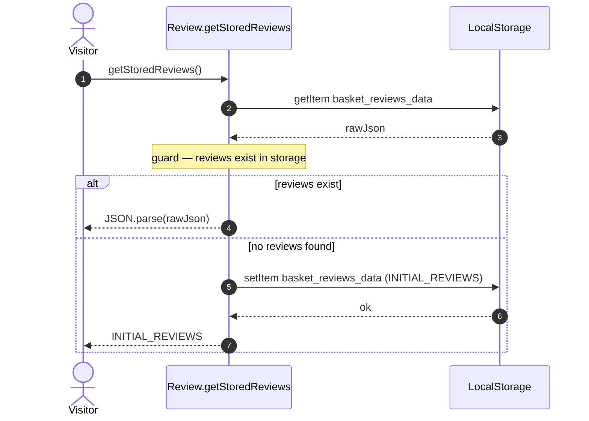

### Review.saveStoredReviews

Persists updated reviews array to local storage and dispatches a change event; callable by a customer leaving feedback.

---

## 9. Favourite

| Field | Type | Key / Notes |
|---|---|---|
| `id` | `string` | Primary key; foreign key to either `Market.id` or `Vendor.id` |

### Favourite.toggleFavourite

Adds or removes a target market or vendor ID from the user's bookmarked list; callable by any user.

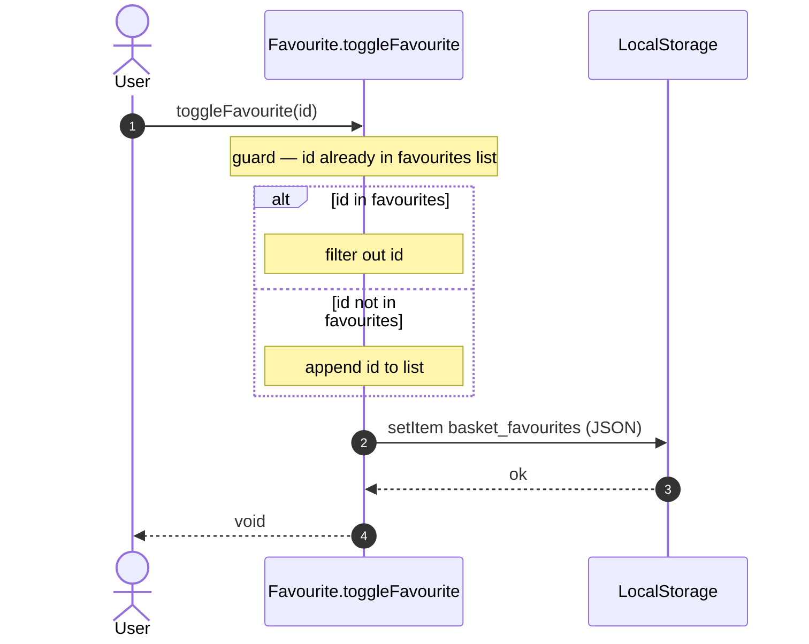

### Favourite.isFavourite

Evaluates whether a given entity identifier is saved in the user's favourites list; callable by any user.

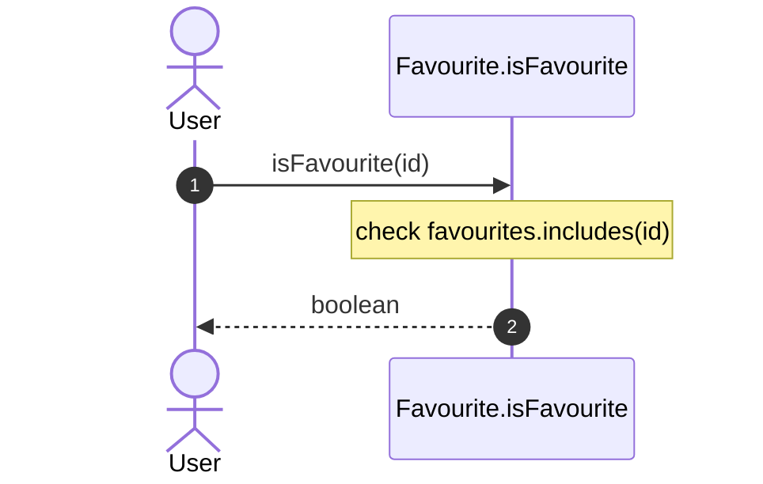

---

## 10. Architectural Boundaries & Cross-References

- **Client-Side Persistence:** Application state is managed via `localStorage` keys (`basket_auth_user`, `basket_cart_items`, `basket_products_data`, `basket_orders_data`, `basket_reviews_data`, `basket_favourites`).
- **Client Route Gating:** Role-based access is evaluated in page components (e.g., `VendorDashboard.jsx` redirects customers to home with a toast).
- **Target Roadmap:** For planned database migration, server-side RBAC, authoritative price validation, and the order transition state machine, see [`ROADMAP.md`](./ROADMAP.md).
