# Basket Specification (As-Built Ground Truth)

> **Document Status:** Actuality / Ground Truth.  
> This specification describes the codebase **exactly as it is currently implemented**.  
> For completed milestones and remaining operational backlog, see [`ROADMAP.md`](./ROADMAP.md).

---

## Architecture Header Block

1. **Trust boundary:** The browser client (React SPA) is untrusted and has direct read-only access only to public catalog tables (`markets`, approved `vendors`, `products`, `reviews`) via the Supabase anon key protected by PostgreSQL Row Level Security (RLS). All authenticated mutations and private reads route through the trusted Express server (`server.ts`), which verifies the Supabase JWT (`Authorization: Bearer <token>`), resolves `actor`, validates input, and executes database writes using `SUPABASE_SERVICE_ROLE_KEY`.
2. **Method contract:** Every server write method takes `actor` as its final parameter, verifies role and resource ownership inside the model method (`server/models/*.ts`), and computes server-derived fields (`id`, `customer_id`, `price_cents_snapshot`, `total_cents`, `status`, `customer_name`). Unsubmitted shopping cart state (`CartItem`) remains local in browser `localStorage` (`basket_cart_items`) until submitted to `POST /api/orders`.
3. **Entity relationships:** `User 1—0..1 Vendor`, `User 1—0..* Order`, `User 1—0..* Favourite`, `Market 1—0..* Vendor`, `Vendor 1—0..* Product`, `Vendor 1—0..* Order`, `Vendor 1—0..* Review`, `Order 1—1..* OrderItem`, `Order 1—0..1 Review`; multi-vendor cart checkout splits items by `vendor_id` into $N$ distinct `Order` records.
4. **File paths:**
   - `User` (`UserModel`) → `server/models/User.ts` (client session hooks in `src/context/AuthContext.jsx`)
   - `Market` → `supabase/schema.sql` / `src/data.js`
   - `Vendor` → `supabase/schema.sql` / `src/data.js`
   - `Product` (`ProductModel`) → `server/models/Product.ts`
   - `CartItem` → `src/context/AuthContext.jsx` (local unsubmitted cart)
   - `Order` (`OrderModel`) → `server/models/Order.ts`
   - `OrderItem` → `supabase/schema.sql` / `server/models/Order.ts`
   - `Review` (`ReviewModel`) → `server/models/Review.ts`
   - `Favourite` (`FavouriteModel`) → `server/models/Favourite.ts`

---

## 1. User (`UserModel` / `Actor`)

| Field | Type | Key / Notes |
|---|---|---|
| `id` | `uuid` | Primary key; references `auth.users(id) on delete cascade` |
| `email` | `text` | Account email synced from Supabase Auth |
| `firstName` (`first_name`) | `text` | User given name |
| `lastName` (`last_name`) | `text` | User family name |
| `role` | `text` | Enum: `'customer' \| 'vendor'`; protected from client update via `prevent_profile_role_escalation()` trigger |
| `city` | `text \| null` | Optional municipality |
| `vendorId` | `string \| null` | Derived on server from `vendors.owner_user_id = id` |
| `vendorName` | `string \| null` | Derived stall name |
| `marketId` | `string \| null` | Derived attended market foreign key |
| `marketName` | `string \| null` | Derived attended market name |
| `isApproved` | `boolean` | `true` for customers; equals `vendors.is_approved` for vendors |
| `createdAt` (`created_at`) | `timestamptz` | Profile creation timestamp |

*Note: Passwords and password hashes are managed exclusively inside Supabase Auth (`auth.users`) and never enter `public.profiles` or API responses.*

### UserModel.resolveActorFromToken(accessToken)

Validates a Supabase JWT bearer token and hydrates the server-side `Actor` (profile + linked vendor stall status); called by `requireActor` middleware on every authenticated API route.

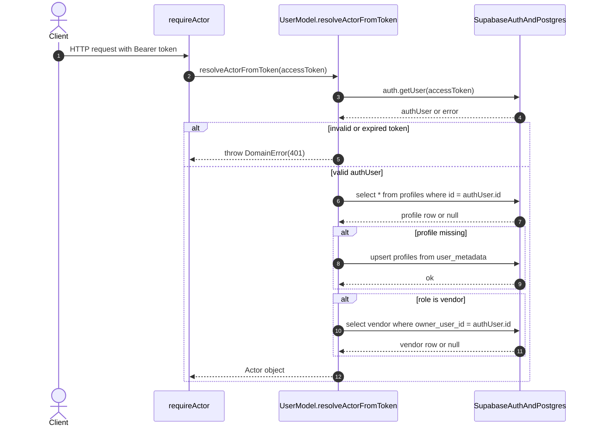

### UserModel.deleteAccount(actor)

Permanently deletes the authenticated user from Supabase Auth (cascading to `profiles`, `favourites`, and detaching/deleting owned rows per schema foreign keys); callable by the authenticated account owner via `DELETE /api/account`.

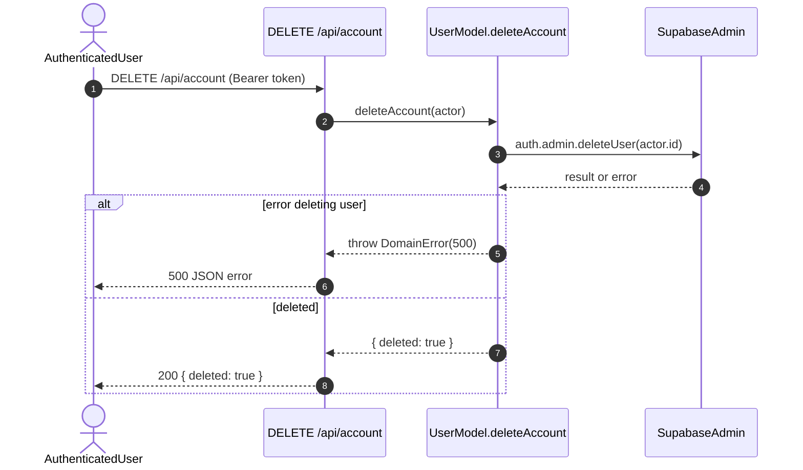

---

## 2. Market

| Field | Type | Key / Notes |
|---|---|---|
| `id` | `text` | Primary key (e.g. `'st-jacobs'`, `'byward'`) |
| `name` | `text` | Formal market name |
| `city` | `text` | Municipality |
| `region` | `text` | Ontario region |
| `address` | `text` | Street address |
| `lat` | `double precision` | Latitude coordinate |
| `lng` | `double precision` | Longitude coordinate |
| `season` | `text` | Operating seasonal schedule |
| `hours_table` | `jsonb` | Array of `{ day, hours }` objects |
| `summary_hours` | `text` | Abbreviated hours for cards |
| `description` | `text` | Market description |
| `announcement` | `jsonb \| null` | Embedded `{ title, date, content, imageKey }` |
| `hero_image_key` | `text` | Asset key (`'hero' \| 'produce' \| 'bakery' \| 'preserves'`) |
| `created_at` | `timestamptz` | Creation timestamp |

**Methods:** none — read-only public catalog table queried via Supabase anon client (`fetchMarkets`, `fetchMarketById` in `src/data.js`). No separate diagram.

---

## 3. Vendor

| Field | Type | Key / Notes |
|---|---|---|
| `id` | `text` | Primary key (e.g. `'v-harvest-table'`) |
| `owner_user_id` | `uuid \| null` | Foreign key to `profiles(id) on delete set null`, indexed |
| `market_id` | `text` | Foreign key to `markets(id) on delete cascade`, indexed |
| `name` | `text` | Farm stand or bakery name |
| `city` | `text` | Home municipality |
| `category` | `text` | Producer category |
| `short_description` | `text` | Summary description |
| `full_description` | `text` | Detailed farm story |
| `stall_location` | `text` | Physical stall location |
| `pickup_instructions` | `text` | Pickup and in-person payment instructions |
| `image_key` | `text` | Thumbnail asset key |
| `banner_image_key` | `text` | Banner asset key |
| `is_approved` | `boolean` | Default `false`; controls public visibility & dashboard publishing |
| `created_at` | `timestamptz` | Creation timestamp |

**Methods:** none — created automatically in pending state by `handle_new_user()` trigger on vendor signup and read publicly when `is_approved = true` via RLS (`fetchVendors`, `fetchVendorDetail` in `src/data.js`). No separate diagram.

---

## 4. Product (`ProductModel`)

| Field | Type | Key / Notes |
|---|---|---|
| `id` | `text` | Primary key (`'p-' || gen_random_uuid()`) |
| `vendor_id` | `text` | Foreign key to `vendors(id) on delete cascade`, indexed |
| `name` | `text` | Product title (max 120 chars) |
| `price_cents` | `integer` | Authoritative unit price in CAD cents (`> 0`) |
| `unit` | `text` | Packaging unit (max 50 chars) |
| `category` | `text` | Whitelisted crop category |
| `description` | `text` | Product description (max 1000 chars) |
| `is_available` | `boolean` | Availability flag (`true` = available this week) |
| `image_key` | `text` | Asset key (`'produce' \| 'bakery' \| 'preserves' \| 'hero'`) |
| `created_at` | `timestamptz` | Creation timestamp |

### ProductModel.create(input, actor)

Validates fields and inserts a new product scoped to `actor.vendorId`; callable only by an approved vendor.

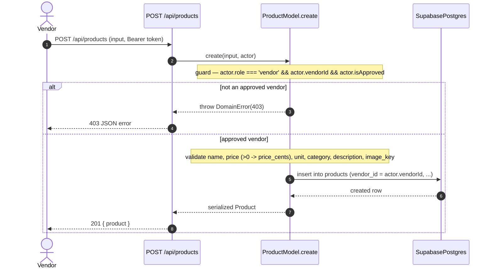

### ProductModel.update(productId, input, actor)

Updates allowed fields on a product after verifying vendor approval and stall ownership; callable only by the owning approved vendor.

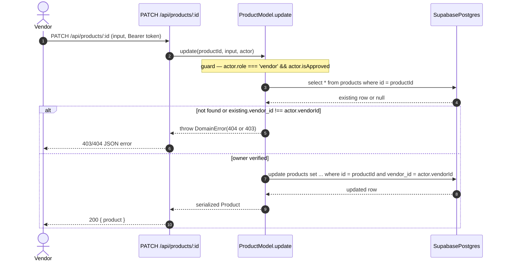

### ProductModel.toggleAvailability(productId, isAvailable, actor)

Delegates toggling `is_available` on an owned product to `ProductModel.update`; callable only by the owning approved vendor.

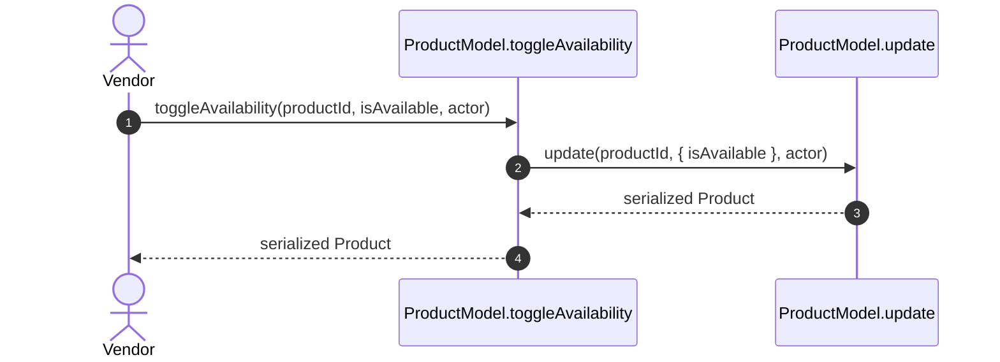

### ProductModel.remove(productId, actor)

Deletes a product after verifying vendor approval and ownership; callable only by the owning approved vendor.

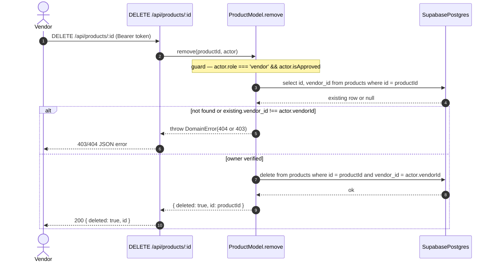

---

## 5. CartItem (Unsubmitted Client Basket)

| Field | Type | Key / Notes |
|---|---|---|
| `id` | `string` | Ephemeral client identifier (`'cart-item-...'`) |
| `productId` | `string` | Reference to `products.id` (re-verified on server at checkout) |
| `name` | `string` | Display name in basket |
| `price` | `number` | Display unit price (ignored by server at checkout) |
| `unit` | `string` | Display unit |
| `image` | `string` | Display image URL |
| `quantity` | `number` | Integer quantity |
| `vendorId` | `string` | Vendor reference for cart grouping |
| `vendorName` | `string` | Display vendor name |
| `marketId` | `string` | Market reference |
| `marketName` | `string` | Display market name |
| `stallLocation` | `string` | Stall note |

### CartItem.addToCart / updateCartQuantity / removeFromCart / clearCart

Client-only state helpers in `src/context/AuthContext.jsx` that persist unsubmitted cart selections in `localStorage` (`basket_cart_items`) until submitted via `OrderModel.createBatch`.

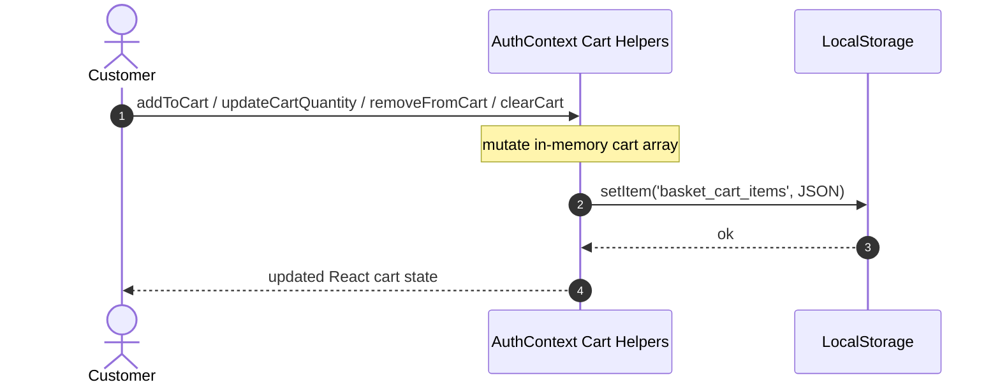

---

## 6. Order (`OrderModel`)

| Field | Type | Key / Notes |
|---|---|---|
| `id` | `text` | Primary key (`'ORD-<6-HEX>'`) |
| `customer_id` | `uuid \| null` | Foreign key to `profiles(id) on delete set null`, indexed |
| `customer_email` | `text` | Derived from `actor.email` |
| `customer_name` | `text` | Derived from `actor.firstName` + `actor.lastName` |
| `vendor_id` | `text` | Foreign key to `vendors(id) on delete cascade`, indexed |
| `market_id` | `text` | Derived from `vendors.market_id`, references `markets(id)` |
| `pickup_window` | `text` | Selected market pickup slot |
| `customer_note` | `text` | Optional note (max 500 chars) |
| `total_cents` | `integer` | Authoritative sum of `price_cents_snapshot * quantity` |
| `status` | `text` | Enum: `'awaiting_pickup' \| 'completed' \| 'cancelled' \| 'no_show'` |
| `payment_method` | `text` | Fixed: `'Pay in person at pickup (Cash, Debit, or e-Transfer)'` |
| `created_at` | `timestamptz` | Creation timestamp |

### OrderModel.listForActor(actor)

Returns orders placed by `actor.id` and (for vendors) incoming orders assigned to `actor.vendorId`; callable by any authenticated user via `GET /api/orders`.

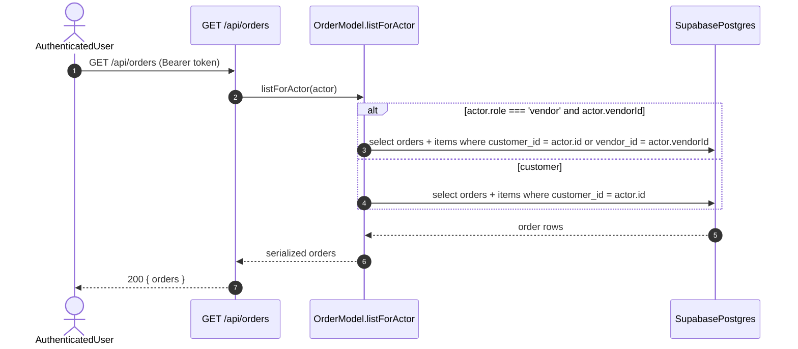

### OrderModel.createBatch(input, actor)

Validates requested product IDs and quantities against live PostgreSQL prices and availability, splits items by `vendor_id`, creates one `orders` row + `order_items` snapshots per vendor with `status = 'awaiting_pickup'`, and returns created orders; callable by any authenticated user via `POST /api/orders`.

```mermaid
sequenceDiagram
    autonumber
    actor C as Customer
    participant API as POST /api/orders
    participant M as OrderModel.createBatch
    participant DB as SupabasePostgres

    C->>API: POST /api/orders ({ items, pickupWindow, customerNote }, Bearer token)
    API->>M: createBatch(input, actor)
    Note over M: validate non-empty items and integer quantities 1..100
    M->>DB: select products + vendors where id in productIds
    DB-->>M: live product and vendor rows
    alt product missing, sold out, or vendor unapproved
        M-->>API: throw DomainError(400 or 409)
        API-->>C: 400/409 JSON error
    else all items valid
        Note over M: group by vendor_id; compute total_cents from DB price_cents
        loop for each vendor group
            M->>DB: insert orders (customer_id = actor.id, status = 'awaiting_pickup', total_cents)
            M->>DB: insert order_items snapshots
        end
        M->>DB: select hydrated created orders
        DB-->>M: order rows
        M-->>API: serialized orders
        API-->>C: 201 { orders }
    end
```

### OrderModel.transition(orderId, targetStatus, actor)

Transitions an `awaiting_pickup` order to `completed`, `no_show` (owning vendor only), or `cancelled` (owning customer only); callable via `PATCH /api/orders/:id/status`.

```mermaid
sequenceDiagram
    autonumber
    actor U as UserOrVendor
    participant API as PATCH /api/orders/:id/status
    participant M as OrderModel.transition
    participant DB as SupabasePostgres

    U->>API: PATCH /api/orders/:id/status ({ status }, Bearer token)
    API->>M: transition(orderId, targetStatus, actor)
    M->>DB: select * from orders where id = orderId
    DB-->>M: existing order or null
    alt order not found or illegal state transition
        M-->>API: throw DomainError(404 or 409)
        API-->>U: 404/409 JSON error
    else transition allowed from awaiting_pickup
        Note over M: guard — completed/no_show requires vendor owner; cancelled requires customer owner
        alt actor lacks ownership/role for targetStatus
            M-->>API: throw DomainError(403)
            API-->>U: 403 JSON error
        else authorized
            M->>DB: update orders set status = targetStatus where id = orderId and status = 'awaiting_pickup'
            DB-->>M: updated order row
            M-->>API: serialized Order
            API-->>U: 200 { order }
        end
    end
```

---

## 7. OrderItem

| Field | Type | Key / Notes |
|---|---|---|
| `id` | `uuid` | Primary key (`gen_random_uuid()`) |
| `order_id` | `text` | Foreign key to `orders(id) on delete cascade`, indexed |
| `product_id` | `text \| null` | Foreign key to `products(id) on delete set null` |
| `name_snapshot` | `text` | Authoritative product name at order time |
| `price_cents_snapshot` | `integer` | Authoritative unit price in cents at order time |
| `unit_snapshot` | `text` | Authoritative unit at order time |
| `quantity` | `integer` | Reserved quantity (`> 0`) |

**Methods:** none — immutable line-item rows inserted exclusively inside `OrderModel.createBatch`. No separate diagram.

---

## 8. Review (`ReviewModel`)

| Field | Type | Key / Notes |
|---|---|---|
| `id` | `text` | Primary key (`'rev-' || gen_random_uuid()`) |
| `vendor_id` | `text` | Foreign key to `vendors(id) on delete cascade`, indexed |
| `order_id` | `text \| null` | Unique foreign key to `orders(id) on delete set null` |
| `customer_id` | `uuid \| null` | Foreign key to `profiles(id) on delete set null` |
| `customer_name` | `text` | Server-derived display name (`FirstName L.`) |
| `rating` | `integer` | Integer `1..5` |
| `comment` | `text` | Review feedback (max 1000 chars) |
| `created_at` | `timestamptz` | Creation timestamp |

### ReviewModel.create(input, actor)

Creates a verified vendor review after confirming `orderId` belongs to `actor.id`, belongs to `vendorId`, is in `'completed'` status, and has not already been reviewed; callable by an authenticated customer via `POST /api/reviews`.

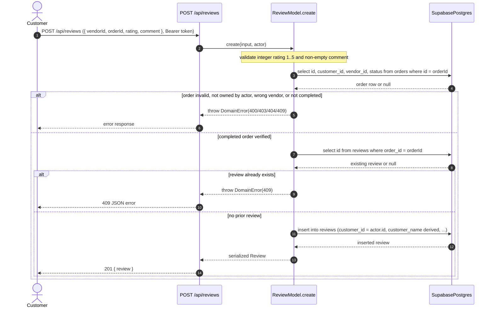

---

## 9. Favourite (`FavouriteModel`)

| Field | Type | Key / Notes |
|---|---|---|
| `user_id` | `uuid` | Composite PK part 1; foreign key to `profiles(id) on delete cascade` |
| `target_type` | `text` | Composite PK part 2; enum `'market' \| 'vendor'` |
| `target_id` | `text` | Composite PK part 3; ID of bookmarked market or vendor |
| `created_at` | `timestamptz` | Creation timestamp |

### FavouriteModel.list(actor)

Returns the list of saved `target_id` values belonging to `actor.id`; callable by an authenticated user via `GET /api/favourites`.

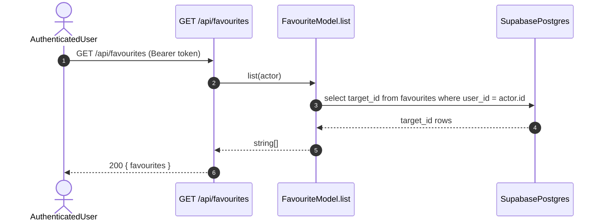

### FavouriteModel.toggle(targetType, targetId, actor)

Toggles a market or vendor bookmark for `actor.id` after confirming the target exists; callable by an authenticated user via `POST /api/favourites/toggle`.

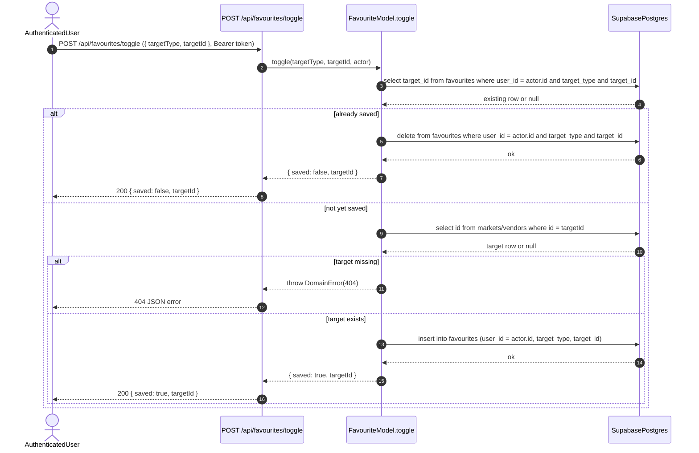

---

## 10. Closure Check

| Check | Status | Implementation Finding |
|---|---|---|
| Every method in every entity section has a diagram, or is declared method-less with a reason | ✅ | All server model methods (`UserModel`, `ProductModel`, `OrderModel`, `ReviewModel`, `FavouriteModel`) and client cart helpers have sequence diagrams; `Market`, `Vendor`, and `OrderItem` are explicitly method-less. |
| Every method called by another method appears as an arrow + method name | ✅ | `ProductModel.toggleAvailability` delegates cleanly to `ProductModel.update` without duplicating logic. |
| Every write takes `actor` as last parameter and enforces ownership inside itself | ✅ | `ProductModel.*`, `OrderModel.*`, `ReviewModel.create`, `FavouriteModel.toggle`, and `UserModel.deleteAccount` all take `actor` last and guard role/ownership internally. |
| Server-derived fields are computed inside methods, not accepted from client | ✅ | `price_cents_snapshot`, `total_cents`, `customer_id`, `customer_name`, `status`, and order/review IDs are derived server-side. |
| Every `alt` corresponds to a real guard or error path | ✅ | All `alt` branches match concrete validation, 401/403/404/409 `DomainError` checks in `server/models/*.ts`. |
| Every FK is stated once, in the entity that owns the column | ✅ | Foreign keys are documented on the child entities owning the columns (`Vendor`, `Product`, `Order`, `OrderItem`, `Review`, `Favourite`). |

---

## 11. Deviations & Open Questions

- **Unsubmitted Cart Storage (`CartItem`):** Shopping cart items stay in browser `localStorage` (`basket_cart_items`) rather than a server table to allow frictionless browsing; all item IDs, availability, and prices are re-validated authoritatively on the server inside `OrderModel.createBatch`.
- **Two-Step Order + OrderItem Insert:** `OrderModel.createBatch` inserts into `orders` and `order_items` across sequential Supabase REST calls rather than a single SQL `BEGIN ... COMMIT` RPC function. Wrapping checkout in a Postgres RPC transaction (plus optional `weekly_quota` stock decrement) is noted in `ROADMAP.md`.
- **Favourite Cleanup on Vendor Delete:** `favourites.target_id` is polymorphic (`'market' \| 'vendor'`) without a relational foreign key; `FavouriteModel.toggle` validates existence at insert time.
